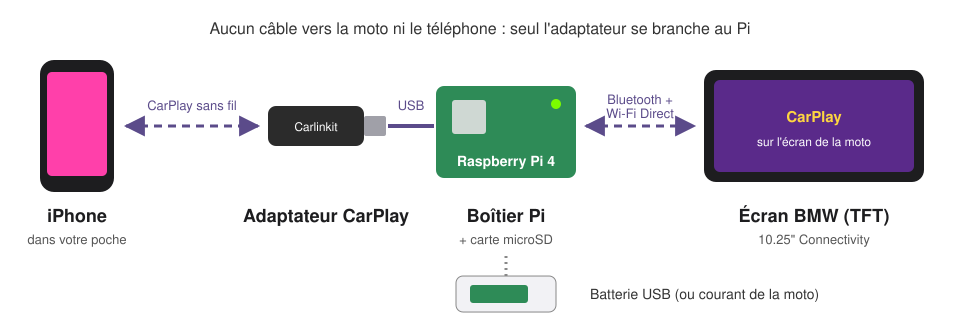
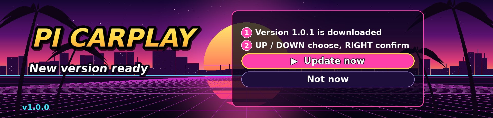

[English](README.md) | **Français**

# Pi CarPlay pour BMW Motorrad

**Apple CarPlay sur l'écran 10,25" de votre moto BMW, 100 % sans fil.**

Un petit boîtier Raspberry Pi et un adaptateur CarPlay font afficher CarPlay sur l'écran de
navigation de votre moto : cartes, musique, messages. Vous le pilotez avec les commandes au
guidon. Rien n'est branché à la moto ni au téléphone ; le boîtier se range sous la selle ou
dans une sacoche de réservoir.




> Projet personnel, sans lien avec BMW ni Apple. Faites l'installation moto à l'arrêt, et
> gardez les yeux sur la route.

**L'installation prend environ 30 minutes, une seule fois.** Ensuite, CarPlay s'affiche tout
seul à chaque sortie.

---

## Étape 1 : achetez le matériel

| | Quoi | Remarques | Exemple |
| --- | --- | --- | --- |
| 1 | **Raspberry Pi 4 Model B** | 1 Go de mémoire suffit largement | [PiShop.ca](https://www.pishop.ca/product/raspberry-pi-4-model-b-1gb/) |
| 2 | **Adaptateur USB CarPlay sans fil Carlinkit, modèle CPC200-CCPA** | **N'achetez qu'un adaptateur dont l'annonce ou la boîte indique clairement CPC200-CCPA** : les autres, même s'ils se ressemblent, ne fonctionnent pas. Testé : Carlinkit A15W (apparaît sous le nom « AutoKit-… ») | [Amazon](https://a.co/d/0bSMkhVc) |
| 3 | **Carte microSD de 32 Go ou plus** | Une carte rapide (marquée A1 ou A2) : le boîtier démarre plus vite | [Amazon.ca](https://www.amazon.ca/Micro-SD-Cards/b?ie=UTF8&node=3381334011) |
| 4 | **Batterie USB de 10 000 mAh** + un **câble USB-C** | Choisissez-en une qui fournit 3 A (15 W) ou plus. Testé : plus de 5 heures de route | Toute bonne marque |
| 5 | Un **boîtier** pour le Pi 4 | Facultatif, mais il protège le Pi | N'importe quel boîtier Pi 4 |

> **À propos de l'adaptateur CarPlay (article 2) :** on trouve beaucoup d'adaptateurs qui se
> ressemblent. Le boîtier ne fonctionne qu'avec le **Carlinkit CPC200-CCPA**. Si la page du
> produit ou la boîte n'indique pas clairement **CPC200-CCPA**, choisissez-en un autre.

Il vous faut aussi :
- une **moto BMW Motorrad avec l'écran Connectivity 10,25" et la navigation**,
- un **iPhone** compatible CarPlay,
- un **ordinateur avec un lecteur de carte microSD**, une seule fois, pour préparer la carte.

## Étape 2 : téléchargez le logiciel

Ouvrez la **[dernière version](https://github.com/macgaver/pi-carplay-motorrad/releases/latest)**
et téléchargez le fichier **`pi-carplay-motorrad-<version>.img.xz`** (environ 900 Mo).

Ne le décompressez pas ; l'étape suivante le lit tel quel.

## Étape 3 : copiez le logiciel sur la carte microSD

1. Installez **[Raspberry Pi Imager](https://www.raspberrypi.com/software/)** (gratuit, pour
   Windows, macOS et Linux) et insérez la carte microSD dans votre ordinateur.
2. Dans Raspberry Pi Imager :
   - **Appareil** : *Raspberry Pi 4*.
   - **Système d'exploitation** : descendez tout en bas, choisissez **Use custom**
     (image personnalisée), puis le fichier téléchargé.
   - **Stockage** : votre carte microSD.
3. Cliquez sur **Suivant**. Si Imager propose de **personnaliser le système** (nom
   d'utilisateur, Wi-Fi…), répondez **Non** / passez : la carte contient déjà tout ce qu'il
   faut.
4. Confirmez, et attendez qu'Imager indique que c'est terminé (quelques minutes).

## Étape 4 (recommandée) : ajoutez votre Wi-Fi maison, pour les mises à jour

Avec votre Wi-Fi maison sur la carte, le boîtier se met à jour quand une nouvelle version
sort (il vous le demande d'abord, sur l'écran de la moto). La moto, elle, n'en a pas besoin.

1. Retirez la carte et réinsérez-la. Un lecteur nommé **`bootfs`** apparaît.
   > Sous Windows, un message peut proposer de **formater** un disque : cliquez sur
   > **Annuler**. C'est l'autre partie de la carte, que Windows ne sait pas lire. Ne la
   > formatez pas.
2. Ouvrez **`bmw-carplay.txt`** sur `bootfs` avec le Bloc-notes (Windows) ou TextEdit (Mac).
3. Remplissez ces trois lignes, puis enregistrez :
   ```
   WIFI_COUNTRY=CA
   WIFI_SSID=Le nom de votre Wi-Fi
   WIFI_PASSWORD=Le mot de passe de votre Wi-Fi
   ```
   `WIFI_COUNTRY` est le code à deux lettres de votre pays : `CA`, `FR`, `BE`, `CH`, `US`, …
4. Éjectez la carte.

## Étape 5 : assemblez le boîtier

1. Glissez la carte microSD dans la fente **sous** le Pi.
2. Branchez l'**adaptateur CarPlay** sur un des ports USB du Pi (n'importe lequel des quatre).
3. Mettez le Pi dans son boîtier.

## Étape 6 : alimentez-le

**Simple : batterie USB.** Branchez la batterie sur le port **USB-C** du Pi. Le Pi démarre dès
qu'il est alimenté. Rechargez la batterie entre les sorties, et débranchez le Pi quand la moto
est stationnée, pour ne pas vider la batterie.

**Avancé : courant de la moto.** Relié à un circuit 12 V qui suit le contact, par un
**convertisseur 12 V → 5 V USB-C (3 A)**, le boîtier démarre et s'arrête avec la moto. Ce
n'est pas encore entièrement testé. Si le câblage d'une moto ne vous est pas familier,
confiez-le à un atelier. Vous avez trouvé une bonne solution ? Partagez-la dans les
[Discussions](https://github.com/macgaver/pi-carplay-motorrad/discussions).

Rangez le boîtier sous la selle ou dans une sacoche de réservoir. Sur la **R1300RT**, il
loge dans le petit coffre sous le siège passager, avec ce
[couvercle de remplacement à imprimer en 3D](https://www.thingiverse.com/thing:7439704/files).

## Étape 7 : jumelez le boîtier avec la moto (une fois)

1. Mettez le contact et alimentez le boîtier. Attendez environ **une minute** qu'il démarre :
   le voyant vert du Pi clignote **lentement** quand il est prêt à être jumelé.
2. Sur l'écran de la moto : **Réglages > Connexions > Appareil mobile > jumeler un nouvel
   appareil**.
3. Choisissez **Pi CarPlay**, et confirmez le code sur la moto. Le boîtier confirme de son
   côté tout seul.

## Étape 8 : connectez votre iPhone (une fois)

Ouvrez la **navigation** de la moto. L'écran indique quoi faire :


1. Sur l'iPhone : **Réglages > Bluetooth**, et touchez l'adaptateur (**AutoKit-…**, le nom
   qu'affiche l'écran de la moto).
2. Touchez **Utiliser CarPlay** quand l'iPhone le demande.

Laissez le Wi-Fi et le Bluetooth de l'iPhone activés : CarPlay sans fil a besoin des deux.

**C'est fait.** Désormais, tout se connecte tout seul.

---

## À chaque sortie

1. Mettez le contact (et alimentez le boîtier s'il est sur batterie).
2. Ouvrez la **navigation** de la moto. CarPlay s'affiche en une minute environ.

| Commande au guidon | Dans CarPlay |
| --- | --- |
| HAUT / BAS | Élément suivant / précédent |
| DROITE | Sélectionner |
| GAUCHE | Retour (maintenue : écran d'accueil) |

- CarPlay s'affiche sur les **deux** écrans de navigation, le grand écran large et la petite
  case carrée, et vous suit quand vous passez de l'un à l'autre.
- Le son de CarPlay passe par l'audio Bluetooth de la moto (votre intercom de casque).
- Les commandes de la moto restent à CarPlay tant qu'il est à l'écran ; elles ne changent pas
  le volume.

## Mises à jour

Si votre Wi-Fi maison est sur la carte (étape 4), le boîtier cherche une nouvelle version
chaque fois qu'il démarre à la maison. S'il y en a une, l'écran de la moto demande :



- **HAUT / BAS** pour choisir, **DROITE** pour confirmer.
- **Update now** (mettre à jour) : gardez le contact ; CarPlay revient en une minute environ,
  dans la nouvelle version.
- **Not now** (plus tard) : CarPlay tout de suite. La question revient au prochain démarrage
  à la maison.

Le numéro de version est affiché dans le coin des écrans du boîtier.

## En cas de problème

| Ce que vous voyez | Que faire |
| --- | --- |
| **« CarPlay dongle not found »** sur l'écran de la moto | L'adaptateur CarPlay n'est pas branché, ou démarre encore. Vérifiez qu'il est sur un port USB du Pi et attendez une minute. |
| La moto ne trouve pas **Pi CarPlay** | Le boîtier a besoin d'environ une minute après la mise sous tension. Vérifiez que son voyant vert clignote lentement. |
| Jumeler une **autre moto** | Éteignez et rallumez le boîtier, et jumelez la nouvelle moto dans les 3 minutes. En dehors de ce délai, seule votre moto peut se jumeler. |
| L'iPhone ne se connecte pas | Activez le Wi-Fi et le Bluetooth de l'iPhone. Sinon, oubliez l'AutoKit dans les réglages Bluetooth de l'iPhone et refaites l'étape 8. |
| L'écran du boîtier clignote, puis la moto se reconnecte | Normal : le boîtier débloque une connexion coincée tout seul, en général en moins de 30 secondes. |
| Texte trop petit dans CarPlay | Sur l'iPhone : désactivez le zoom de l'affichage et choisissez une taille de texte plus grande pour CarPlay dans les réglages d'accessibilité. |


**Voyant vert du Pi :**

| Voyant | Signification |
| --- | --- |
| Clignotement lent | En attente de jumelage avec la moto |
| Clignotement rapide | Connexion à la moto en cours |
| Allumé, bref clignotement toutes les 2 s | Connecté à la moto, en attente de l'iPhone |
| Allumé fixe | CarPlay à l'écran de la moto |

## Réglages (facultatif)

`bmw-carplay.txt` sur la carte (étape 4) contient les réglages, relus à chaque démarrage du
boîtier. Modifiez une ligne, ou ajoutez-la si elle n'y est pas. Les plus utiles :

| Réglage | Valeurs | Effet |
| --- | --- | --- |
| `ZOOM` | `small`, `normal`, `large` | Taille de CarPlay dans la petite case carrée |
| `SMALL_NAV_VIEW` | `center`, `left`, `right` | Partie de la carte affichée dans la case carrée |
| `CARPLAY_NIGHT` | `0`, `1` | Mode sombre de CarPlay |
| `BT_NAME` | un nom | Le nom qu'affiche la moto au jumelage |
| `AUTO_UPDATE` | `on`, `any`, `off` | Mises à jour sur le Wi-Fi maison (`any` : aussi sur un partage de connexion ; `off` : jamais) |

## Aide et idées

Des questions, des idées, une bonne façon d'alimenter le boîtier par la moto ? Partagez-les
dans les [Discussions](https://github.com/macgaver/pi-carplay-motorrad/discussions).

Développeurs : le fonctionnement, le code et la construction du logiciel sont dans
[docs/DEVELOPERS.fr.md](docs/DEVELOPERS.fr.md).

Licence MIT, voir [LICENSE](LICENSE).
