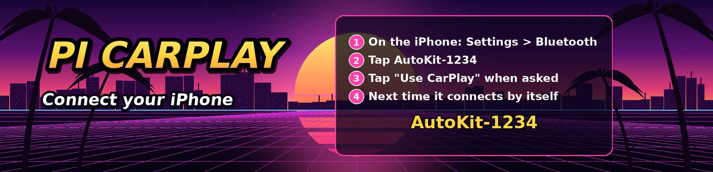
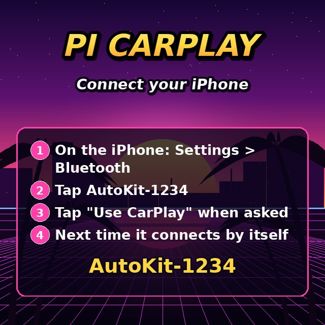

[English](README.md) | **Français**

# pi-carplay-motorrad (100 % sans fil)

Apple CarPlay sur l'écran TFT 10,25" d'une moto BMW Motorrad, grâce à un Raspberry Pi et à
un adaptateur CarPlay sans fil Carlinkit. Le Pi se fait passer pour un téléphone qui roule
l'application BMW Connected : les écrans de navigation de la moto affichent CarPlay, et les
commandes au guidon le pilotent. Aucun câble vers la moto ni vers l'iPhone : l'iPhone parle à
l'adaptateur en CarPlay sans fil, et le Pi parle au TFT en Bluetooth et en Wi-Fi Direct. Le
programme qui tourne sur le Pi s'appelle `tftpush`.



*L'écran que la moto affiche tant que l'iPhone n'est pas connecté (grand écran de
navigation). Une fois connecté, CarPlay le remplace.*

> Projet personnel expérimental, sans lien avec BMW ni Apple. Faites l'installation moto à
> l'arrêt, et gardez les yeux sur la route.

## Ce qui fonctionne

Testé sur une vraie moto (TFT 10,25", Pi 4, Carlinkit A15W, iPhone) :

- CarPlay sur les **deux** écrans de navigation : le grand écran large (1920x464) et la
  petite case carrée (640x640), avec passage de l'un à l'autre en roulant.
- Commandes au guidon : HAUT/BAS = élément suivant/précédent, DROITE = sélectionner,
  GAUCHE = retour (modifiable avec `KEYMAP`). Les commandes restent à CarPlay ; elles ne
  changent pas le volume.
- Le son de CarPlay passe par l'audio Bluetooth de la moto.
- Aucune manipulation : le Pi démarre avec le contact, trouve la moto et l'iPhone tout seul,
  et se rétablit de lui-même quand le Bluetooth ou le Wi-Fi décroche (voir
  [Reprise automatique](#reprise-automatique)).
- Jumelage réservé à votre moto : une fois jumelée, seule cette moto peut se jumeler de
  nouveau, sauf pendant les 3 minutes après la mise sous tension (pour jumeler un nouveau
  TFT sans ordinateur).
- Plusieurs heures de route sans décrochage.

## Matériel requis

- Un **Raspberry Pi 4** (1 Go suffit largement : l'ensemble utilise environ 265 Mo pendant
  la diffusion). Au Canada :
  [Raspberry Pi 4 Model B 1 Go chez PiShop.ca](https://www.pishop.ca/product/raspberry-pi-4-model-b-1gb/).
  Un Pi 5 devrait fonctionner avec la même image, mais n'a pas encore été
  essayé ; il lui faut une alimentation 5 V / 5 A, sinon il limite ses ports USB et
  l'adaptateur risque de décrocher.
- Un **adaptateur USB CarPlay sans fil Carlinkit** (famille CPC200-CCPA, USB
  `1314:1520/1521` ; testé : A15W, qui apparaît sous le nom « AutoKit-xxxx »). Par exemple :
  [adaptateur USB CarPlay sur Amazon](https://a.co/d/0bSMkhVc).
- Une carte microSD rapide de **32 Go ou plus** (A1/A2, U3), pour un démarrage rapide à
  chaque mise du contact. Par exemple : [cartes microSD sur Amazon.ca](https://www.amazon.ca/Micro-SD-Cards/b?ie=UTF8&node=3381334011).
- De quoi alimenter le Pi. Pour l'instant, il a été testé sur une **batterie USB de
  10 000 mAh** : aucun problème pendant plus de 5 heures de route. L'alimentation par un des
  fils 12 V internes de la moto (pour qu'il suive le contact) sera testée cet hiver. Vous avez
  trouvé une bonne solution ? Partagez-la dans les
  [Discussions](https://github.com/macgaver/bmw-carplay/discussions) de ce dépôt.
  Vous pouvez imprimer 3D ce model pour remplacer le couvercle du petit coffre sous le siège passager de la R1300RT: https://www.thingiverse.com/thing:7439704/files

- Une moto BMW Motorrad avec le TFT Connectivity 10,25" et la navigation.

## Démarrage rapide

1. Construisez l'image de la carte SD (`image/build.sh`, voir
   [image/README.md](image/README.md), en anglais) et gravez-la.
2. Facultatif : ouvrez la partition `bootfs` de la carte sur n'importe quel ordinateur et
   inscrivez votre Wi-Fi maison dans `bmw-carplay.txt` (seulement pour les mises à jour et
   SSH ; la moto n'en a pas besoin).
3. Branchez l'adaptateur sur le Pi et alimentez le Pi.
4. Sur la moto : Réglages > Connexions > Appareil mobile > nouveau jumelage, choisissez
   **Pi CarPlay** et confirmez le code.
5. Sur l'iPhone : Réglages > Bluetooth, touchez l'adaptateur (AutoKit-xxxx), puis
   « Utiliser CarPlay ». Le TFT affiche aussi ces étapes.
6. Ouvrez la navigation de la moto. Ensuite, tout se connecte tout seul à chaque sortie.

Voyant vert du Pi : clignotement lent = en attente de jumelage, clignotement rapide =
connexion en cours, fixe = image sur le TFT.

## Réglages

Tous les réglages sont dans `bmw-carplay.txt`, sur la partition `bootfs` de la carte ; ils
sont relus à chaque démarrage. Les plus utiles :

| Réglage | Valeurs | Effet |
| --- | --- | --- |
| `ZOOM` | `small`, `normal` (défaut), `large` | Taille de CarPlay dans la petite case carrée |
| `SMALL_NAV_VIEW` | `center` (défaut), `left`, `right` | Partie de l'image large montrée dans la case carrée |
| `PAIRING` | `auto` (défaut), `always`, `off` | Quand le Pi accepte un nouveau jumelage |
| `PAIRING_WINDOW` | secondes, `180` par défaut | Délai après la mise sous tension pendant lequel un autre TFT peut se jumeler |
| `KEYMAP` | p. ex. `UP=left,DOWN=right` | Touche du guidon vers commande CarPlay |
| `CARPLAY_NIGHT` | `0`, `1` | Mode sombre de CarPlay |
| `PHONE_BATTERY`, `PHONE_SIGNAL` | `auto`, `off`, `0`-`100` | Ce qu'affiche la barre d'état de la moto (l'adaptateur ne transmet pas les vraies valeurs de l'iPhone) |
| `AUTO_UPDATE` | `on` (par défaut), `any`, `off` | Au démarrage sur le Wi-Fi maison (`any` : aussi un partage de connexion), télécharge la nouvelle version et demande sur le TFT : mettre à jour maintenant / plus tard |

La liste complète, avec explications, est dans `tftpush/auto.py` (`DEFAULTS`).

Pour un texte plus gros sur le grand écran, passez par l'iPhone : désactivez le zoom de
l'affichage et choisissez une plus grande taille de texte pour CarPlay dans les réglages
d'accessibilité de l'iPhone. (CarPlay s'ajuste à la hauteur de l'écran ; changer la taille
de l'image côté Pi n'y change rien.)

## Reprise automatique

Le Pi n'abandonne jamais ; chaque panne mène à une nouvelle tentative :

| Problème | Réaction du Pi |
| --- | --- |
| Moto éteinte ou hors de portée | Réessaie toutes les 6 s |
| Le Bluetooth décroche pendant la connexion | Nouvelle tentative aussitôt |
| Le TFT accepte la connexion mais l'ignore (vu après un plein d'essence) | Après 3 essais, redémarre sa radio Bluetooth ; après 6, tout son logiciel Bluetooth |
| Le Wi-Fi Direct échoue ou décroche en roulant | Détecté en 15 s, nouvelle tentative |
| Le TFT affiche l'application mais ne demande aucune image | Redemande après 2 s, nouvelle session après 6 s |
| Service Bluetooth redémarré ou adaptateur perdu | tftpush redémarre et refait toute la configuration |
| L'iPhone ne se reconnecte pas à l'adaptateur | Demande à l'adaptateur de se reconnecter toutes les 15 s |
| Plantage, quel qu'il soit | systemd relance tftpush en moins de 5 s |

## Fonctionnement

1. **Bluetooth.** Le Pi ressemble à un téléphone : classe d'appareil `0x5a020c`, audio
   (A2DP/HFP) connecté, et l'enregistrement SPP de BMW annoncé (UUID
   `c707050e-efae-1449-3913-c191e5bb32dc`).
2. **Ice.** Il ouvre une connexion RFCOMM vers le service BMW du TFT et parle ZeroC Ice
   (protocole 1.0, encodage 1.1) : `createMySpinICESession`, Hello, code de pays, puis
   `getMySpinICEveh(WLAN_CREDENTIALS_P2P)` renvoie le nom et le NIP Wi-Fi Direct du TFT.
3. **Wi-Fi Direct.** Il rejoint le groupe du TFT avec ce NIP WPS et signale « connecté ».
   Un adaptateur Wi-Fi USB est utilisé s'il y en a un ; sinon la radio intégrée est
   empruntée (le Wi-Fi maison décroche alors tant que le lien avec la moto est actif).
4. **mySPIN.** Le TFT annonce son point d'accès en JSON sur UDP 8158. Le Pi s'y connecte en
   TCP, fait la poignée de main mySPIN de Bosch et déclare les applications BMW.
5. **Écrans.** Chaque écran de navigation demande ses images de son côté (`screen_id`,
   taille). Le Pi répond à chaque FrameRequest par un JPEG exactement à cette taille, limité
   à environ 30 Ko (ce que le TFT accepte). Quand le motard change d'écran, le Pi sonde les
   autres écrans (type 168) et réenregistre le nouveau (type 164), ce qui garde les deux
   écrans actifs dans une même session.
6. **CarPlay.** L'iPhone se connecte à l'adaptateur en CarPlay sans fil ; l'adaptateur
   envoie la vidéo H.264 en 1920x464 par USB. Le Pi la décode en logiciel (le décodeur
   matériel du Pi 4 retient 22 images) et ne garde que l'image la plus récente. La case
   carrée reçoit un découpage carré centré sur la carte.
7. **Commandes.** Les touches du guidon arrivent comme CustomData mySPIN et partent vers
   l'adaptateur comme commandes de molette CarPlay. Le Pi envoie `MMC_FOCUS` par Ice quand
   son application est à l'avant-plan, pour que le TFT cesse d'utiliser les touches pour le
   volume.

Les formats de protocole viennent de la rétro-ingénierie publique de
[MOTO-HUB](https://github.com/vincenzobpt/MOTO-HUB) et
[open-connected-tft](https://github.com/vandelayautollc/open-connected-tft). Ce code est une
implémentation indépendante sous licence MIT ; aucun code n'a été copié de ces projets.

## Plan du code

| Module | Rôle |
| --- | --- |
| `tftpush/auto.py` | Mode autonome : réglages, agent et verrou de jumelage, boucle de session, reprise, voyant |
| `tftpush/bt.py` | Enregistrement SDP, connexion RFCOMM avec reprise, trames Ice et battement de cœur |
| `tftpush/ice.py`, `tftpush/ice_dialog.py` | Codec Ice ; dialogue Bluetooth jusqu'aux identifiants Wi-Fi Direct |
| `tftpush/wifi.py`, `tftpush/p2p.py` | Choix de l'interface Wi-Fi, `wpa_supplicant` dédié, connexion Wi-Fi Direct |
| `tftpush/myspin.py`, `tftpush/session.py` | Paquets mySPIN, session TCP, images par écran, surveillance des démarrages bloqués |
| `tftpush/carlinkit/` | Protocole USB Carlinkit, pilote de l'adaptateur, simulateur |
| `tftpush/video.py` | Décodage H.264, image la plus récente, découpage pour la case carrée, JPEG par taille d'écran |
| `tftpush/carplay.py` | Relie adaptateur, vidéo, touches et son ; écrans d'état |
| `tftpush/cards.py` | Les écrans d'état (dessinés par le code, sans fichiers image) |
| `tftpush/carplay_input.py`, `tftpush/carplay_audio.py` | Touches vers CarPlay ; son de CarPlay vers la moto |
| `tftpush/phone_status.py` | Batterie et signal pour la barre d'état de la moto (mains libres) |
| `tftpush/fake_tft.py` | Simulateur du TFT pour les essais sur table |
| `image/` | Construit l'image de carte SD prête à graver |
| `tools/deploy.sh` | Copie le code sur un Pi et redémarre le service |

## Essai sur table (n'importe quel Linux, sans moto)

```sh
python3 -m venv .venv && . .venv/bin/activate
pip install -e '.[test,carplay]'
pytest -q
tftpush carplay-desk --out frames   # faux adaptateur + faux TFT : tout le chemin CarPlay
```

La case carrée affiche le même écran d'état, empilé :


