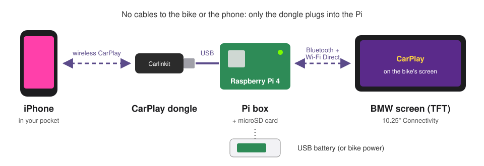
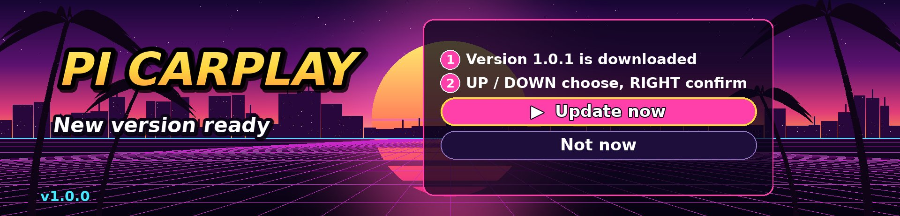
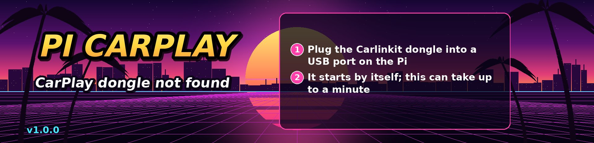

**English** | [Français](README.fr.md)

# Pi CarPlay for BMW Motorrad

**Apple CarPlay on the 10.25" screen of your BMW motorcycle, 100% wireless.**

A small Raspberry Pi box and a CarPlay adapter make your bike's navigation screen show
CarPlay: maps, music, messages. You drive it with the handlebar controls. Nothing is wired
to the bike or the phone; you put the box under the seat or in a tank bag.




> Hobby project, not affiliated with BMW or Apple. Do the setup with the bike parked, and
> keep your eyes on the road.

**Setup takes about 30 minutes, once.** After that, CarPlay comes up by itself every time
you ride.

---

## Step 1: Buy the parts

| | What | Notes | Example |
| --- | --- | --- | --- |
| 1 | **Raspberry Pi 4 Model B** | 1 GB of memory is plenty | [PiShop.ca](https://www.pishop.ca/product/raspberry-pi-4-model-b-1gb/) |
| 2 | **Carlinkit wireless CarPlay USB adapter, model CPC200-CCPA** | **Only buy one whose listing or box clearly says CPC200-CCPA**: other adapters, even similar-looking ones, won't work. Tested: Carlinkit A15W (shows up as "AutoKit-…") | [Amazon](https://a.co/d/0bSMkhVc) |
| 3 | **microSD card, 32 GB or more** | A fast one (marked A1 or A2): the box starts faster | [Amazon.ca](https://www.amazon.ca/Micro-SD-Cards/b?ie=UTF8&node=3381334011) |
| 4 | **USB battery pack, 10,000 mAh** + a **USB-C cable** | Pick one that gives 3 A (15 W) or more. Tested: over 5 hours of riding | Any good brand |
| 5 | A **case** for the Pi 4 | Optional, but it protects the box | Any Pi 4 case |

> **About the CarPlay adapter (part 2):** many look-alike adapters are sold. The box only
> works with the **Carlinkit CPC200-CCPA**. If the product page or the box doesn't clearly
> say **CPC200-CCPA**, pick another one.

You also need:
- a **BMW Motorrad bike with the 10.25" Connectivity screen and navigation**,
- an **iPhone** with CarPlay,
- a **computer with a microSD card reader**, just once, to prepare the card.

## Step 2: Download the software

Open the **[latest release](https://github.com/macgaver/pi-carplay-motorrad/releases/latest)**
and download the file named **`pi-carplay-motorrad-<version>.img.xz`** (about 900 MB).

Don't unzip it; the next step reads it as it is.

## Step 3: Put the software on the microSD card

1. Install **[Raspberry Pi Imager](https://www.raspberrypi.com/software/)** (free, for
   Windows, macOS and Linux) and put the microSD card in your computer.
2. In Raspberry Pi Imager:
   - **Device**: *Raspberry Pi 4*.
   - **Operating system**: scroll to the bottom, pick **Use custom**, and choose the file
     you downloaded.
   - **Storage**: your microSD card.
3. Click **Next**. If Imager offers to **customise the OS** (user name, Wi-Fi…), say
   **No** / skip it: the card already has everything it needs.
4. Confirm, and wait until Imager says it's done (a few minutes).

## Step 4 (recommended): Add your home Wi-Fi, for automatic updates

With your home Wi-Fi on the card, the box updates itself when a new version comes out (it
asks you first, on the bike's screen). The bike itself doesn't need it.

1. Take the card out and put it back in. A drive called **`bootfs`** appears.
   > On Windows, a message may offer to **format** a disk: click **Cancel**. That is the
   > card's other part, which Windows can't read. Don't format it.
2. Open **`bmw-carplay.txt`** on `bootfs` with Notepad (Windows) or TextEdit (Mac).
3. Fill in these three lines, then save:
   ```
   WIFI_COUNTRY=CA
   WIFI_SSID=The name of your Wi-Fi
   WIFI_PASSWORD=Your Wi-Fi password
   ```
   `WIFI_COUNTRY` is your country's two-letter code: `CA`, `US`, `FR`, `DE`, `GB`, …
4. Eject the card.

## Step 5: Put the box together

1. Slide the microSD card into the slot **under** the Pi.
2. Plug the **CarPlay adapter** into one of the Pi's USB ports (any of the four).
3. Put the Pi in its case.

## Step 6: Power it

**Simple: USB battery pack.** Plug the battery into the Pi's **USB-C** port. The Pi starts as
soon as it gets power. Charge the battery between rides, and unplug the Pi when the bike is
parked, so the battery doesn't run flat.

**Advanced: bike power.** Wired to a 12 V circuit that follows the ignition, through a
**12 V → 5 V USB-C converter (3 A)**, the box starts and stops with the bike. This hasn't
been fully tested yet. If you're not comfortable with motorcycle wiring, have a shop do it.
If you find a good setup, please share it in the
[Discussions](https://github.com/macgaver/pi-carplay-motorrad/discussions).

Put the box under the seat or in a tank bag. On the **R1300RT**, it fits in the small
compartment under the passenger seat, with this
[3D-printable replacement cover](https://www.thingiverse.com/thing:7439704/files).

## Step 7: Pair the box with the bike (once)

1. Turn the ignition on and power the box. Wait about **one minute** while it starts: the
   green light on the Pi blinks **slowly** when it's ready to pair.
2. On the bike's screen: **Settings > Connections > Mobile device > pair a new device**.
3. Choose **Pi CarPlay**, and confirm the code on the bike. The box confirms its side by
   itself.

## Step 8: Connect your iPhone (once)

Open the **navigation** on the bike. The screen shows what to do:


1. On the iPhone: **Settings > Bluetooth**, and tap the adapter (**AutoKit-…**, the name
   the bike's screen shows).
2. Tap **Use CarPlay** when the iPhone asks.

Keep the iPhone's Wi-Fi and Bluetooth on: wireless CarPlay needs both.

**Done.** From now on, everything connects by itself.

---

## Every ride

1. Turn the ignition on (and power the box if it's on a battery).
2. Open the **navigation** on the bike. CarPlay appears within about a minute.

| Handlebar control | In CarPlay |
| --- | --- |
| UP / DOWN | Next / previous item |
| RIGHT | Select |
| LEFT | Back (hold it: home screen) |

- CarPlay shows on **both** navigation screens, the big wide one and the small square
  box, and follows you when you switch between them.
- CarPlay sound plays through the bike's Bluetooth audio (your helmet headset).
- The bike's controls stay with CarPlay while it's on screen; they don't change the
  volume.

## Updates

If your home Wi-Fi is on the card (step 4), the box looks for a new version each time it
starts at home. When there is one, the bike's screen asks:



- **UP / DOWN** choose, **RIGHT** confirms.
- **Update now**: keep the ignition on; CarPlay is back in about a minute, on the new
  version.
- **Not now**: CarPlay right away. It asks again next time the box starts at home.

The version number is shown in the corner of the box's screens.

## If something doesn't work

| What you see | What to do |
| --- | --- |
| **"CarPlay dongle not found"** on the bike's screen | The CarPlay adapter isn't plugged in, or is still starting. Check it's in a USB port on the Pi and wait a minute. |
| The bike doesn't list **Pi CarPlay** | The box needs about a minute after power-up. Check its green light blinks slowly. |
| Pairing a **different bike** | Switch the box off and on, and pair the new bike within 3 minutes. Only your bike can pair outside of that. |
| The iPhone doesn't connect | Turn the iPhone's Wi-Fi and Bluetooth on. If it still won't, forget the AutoKit in the iPhone's Bluetooth settings and do step 8 again. |
| The box's screen flashes, then the bike reconnects | Normal: the box fixes a stuck connection by itself, usually within 30 seconds. |
| Text too small in CarPlay | On the iPhone: turn Display Zoom off and choose a larger text size for CarPlay in the Accessibility settings. |



**Green light on the Pi:**

| Light | Meaning |
| --- | --- |
| Slow blink | Waiting to be paired with the bike |
| Fast blink | Connecting to the bike |
| On, short blink every 2 s | Connected to the bike, waiting for the iPhone |
| Steady on | CarPlay on the bike's screen |

## Settings (optional)

`bmw-carplay.txt` on the card (step 4) holds the settings, read each time the box starts.
Change a line, or add it if it isn't there. The most useful ones:

| Setting | Values | What it does |
| --- | --- | --- |
| `ZOOM` | `small`, `normal`, `large` | Size of CarPlay in the small square nav box |
| `SMALL_NAV_VIEW` | `center`, `left`, `right` | Which part of the map the square box shows |
| `CARPLAY_NIGHT` | `0`, `1` | CarPlay dark mode |
| `BT_NAME` | any name | The name the bike shows when pairing |
| `AUTO_UPDATE` | `on`, `any`, `off` | Updates on the home Wi-Fi (`any`: also on a phone hotspot; `off`: never) |

## Help and ideas

Questions, ideas, a good way to power the box from the bike? Share them in the
[Discussions](https://github.com/macgaver/pi-carplay-motorrad/discussions).

Developers: how it works, the code, and building the software yourself are in
[docs/DEVELOPERS.md](docs/DEVELOPERS.md).

MIT license, see [LICENSE](LICENSE).
