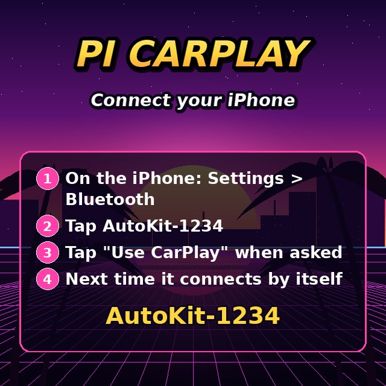

**English** | [Français](DEVELOPERS.fr.md)

# pi-carplay-motorrad: developer guide

How it works inside, the code, and how to build and release. Riders: see the
[main README](../README.md) instead.

- Building the SD-card image yourself, releases and the self-update: [image/README.md](../image/README.md)
- The original Phase 2 (CarPlay) plan and notes: [phase2-plan.md](phase2-plan.md)

## All settings

All settings are in `bmw-carplay.txt` on the card's `bootfs` partition, read at every boot.
The most useful ones:

| Setting | Values | What it does |
| --- | --- | --- |
| `ZOOM` | `small`, `normal` (default), `large` | Size of CarPlay in the small square nav box |
| `SMALL_NAV_VIEW` | `center` (default), `left`, `right` | Which part of the wide picture the square box shows |
| `PAIRING` | `auto` (default), `always`, `off` | When the Pi accepts a new pairing |
| `PAIRING_WINDOW` | seconds, default `180` | How long after power-up another TFT may pair |
| `KEYMAP` | e.g. `UP=left,DOWN=right` | Handlebar key to CarPlay command |
| `CARPLAY_NIGHT` | `0`, `1` | CarPlay dark mode |
| `PHONE_BATTERY`, `PHONE_SIGNAL` | `auto`, `off`, `0`-`100` | What the bike's status bar shows (the dongle doesn't pass the iPhone's real values) |
| `AUTO_UPDATE` | `on` (default), `any`, `off` | At power-up on the home Wi-Fi (`any`: also a hotspot), download a new release and ask on the TFT: Update now / Not now |

The full list, with explanations, is in `tftpush/auto.py` (`DEFAULTS`).

For bigger text on the wide screen, use the iPhone itself: turn Display Zoom off and pick a
larger text size for CarPlay in the iPhone's Accessibility settings. (CarPlay sizes itself to
the screen height, so a different picture size from the Pi doesn't help.)

## Recovery

The Pi never gives up; every failure ends in a new attempt:

| Problem | What the Pi does |
| --- | --- |
| Bike off or out of range | Tries again every 6 s |
| Bluetooth drops while connecting | New attempt at once |
| The TFT takes the connection but ignores it (seen after a fuel stop) | After 3 tries, restarts its Bluetooth radio; after 6, all its Bluetooth software |
| Wi-Fi Direct fails, or drops while riding | Detected within 15 s, new attempt |
| The TFT shows the app but asks for no picture | Asks again after 2 s, new session after 6 s |
| Bluetooth service restarted or adapter lost | tftpush restarts and sets everything up again |
| iPhone not reconnecting to the dongle | Asks the dongle to reconnect every 15 s |
| Any crash | systemd restarts tftpush within 5 s |

## How it works

1. **Bluetooth.** The Pi looks like a phone: class of device `0x5a020c`, media (A2DP/HFP)
   connected, and the BMW SPP record advertised (UUID `c707050e-efae-1449-3913-c191e5bb32dc`).
2. **Ice.** It opens RFCOMM to the TFT's BMW service and speaks ZeroC Ice (protocol 1.0,
   encoding 1.1): `createMySpinICESession`, Hello, country code, then
   `getMySpinICEveh(WLAN_CREDENTIALS_P2P)` returns the TFT's Wi-Fi Direct name and PIN.
3. **Wi-Fi Direct.** It joins the TFT's group with that WPS PIN and reports "connected". A
   USB Wi-Fi adapter is used if present; otherwise the onboard radio is borrowed (the home
   Wi-Fi then drops while the bike link is up).
4. **mySPIN.** The TFT announces its endpoint as JSON on UDP 8158. The Pi connects over TCP,
   runs the Bosch mySPIN handshake and declares the BMW apps.
5. **Screens.** Each nav screen asks for frames on its own (`screen_id`, size). The Pi answers
   each FrameRequest with one JPEG at exactly that size, capped at about 30 KB (what the TFT
   accepts). When the rider switches screens, the Pi pings the other screens (type 168) and
   registers the new one again (type 164), which keeps both screens alive in one session.
6. **CarPlay.** The iPhone connects to the dongle over wireless CarPlay; the dongle sends
   H.264 video at 1920x464 over USB. The Pi decodes it in software (the Pi 4's hardware
   decoder holds back 22 frames) and keeps only the newest picture. The square box gets a
   square cut centred on the map.
7. **Controls.** Handlebar keys arrive as mySPIN CustomData and go to the dongle as CarPlay
   knob commands. The Pi sends `MMC_FOCUS` over Ice when its app is in front, so the TFT stops
   using the keys for volume.

Protocol layouts come from the public reverse-engineering in
[MOTO-HUB](https://github.com/vincenzobpt/MOTO-HUB) and
[open-connected-tft](https://github.com/vandelayautollc/open-connected-tft). This code is an
independent MIT implementation; no code was copied from either project.

## Code map

| Module | Job |
| --- | --- |
| `tftpush/auto.py` | Headless mode: settings, pairing agent and lock, session loop, recovery, LED |
| `tftpush/bt.py` | SDP record, RFCOMM connect with retry, Ice framing and heartbeat |
| `tftpush/ice.py`, `tftpush/ice_dialog.py` | Ice codec; Bluetooth dialogue up to the Wi-Fi Direct credentials |
| `tftpush/remotehmi.py`, `tftpush/hmi.json` | Replays the captured `RemoteHMI_App` replies that make the bike un-grey its Navigation menu (on by default; `TFTPUSH_HMI_CAPTURE=` turns it off) |
| `tftpush/wifi.py`, `tftpush/p2p.py` | Wi-Fi interface choice, own `wpa_supplicant`, Wi-Fi Direct join |
| `tftpush/myspin.py`, `tftpush/session.py` | mySPIN packets, TCP session, per-screen frames, stuck-start watchdog |
| `tftpush/carlinkit/` | Carlinkit USB protocol, dongle driver, desk simulator |
| `tftpush/video.py` | H.264 decoding, newest picture, small-nav cut, JPEG per screen size |
| `tftpush/carplay.py` | Ties dongle, video, keys and audio together; status screens |
| `tftpush/cards.py` | The status screens (drawn in code, no image files) |
| `tftpush/carplay_input.py`, `tftpush/carplay_audio.py` | Keys to CarPlay; CarPlay audio to the bike |
| `tftpush/phone_status.py` | Battery and signal for the bike's status bar (hands-free) |
| `tftpush/fake_tft.py` | Desk simulator of the TFT |
| `image/` | Builds the ready-to-flash SD-card image |
| `tools/deploy.sh` | Copies the code to a Pi and restarts the service |

## Desk test (any Linux box, no bike)

```sh
python3 -m venv .venv && . .venv/bin/activate
pip install -e '.[test,carplay]'
pytest -q
tftpush carplay-desk --out frames   # fake dongle + fake TFT: the whole CarPlay path
```

The square nav box shows the same status screen, stacked:


